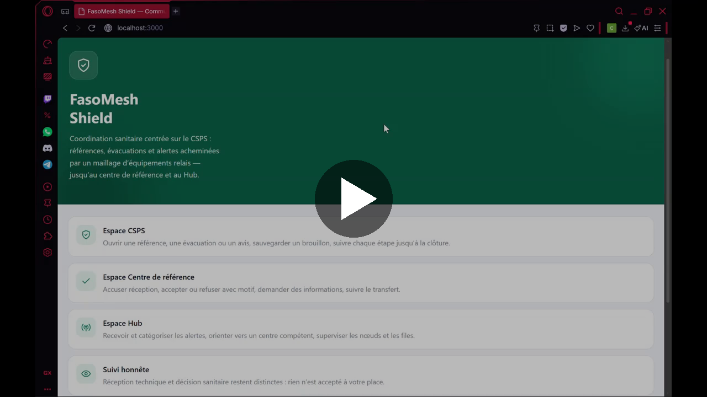
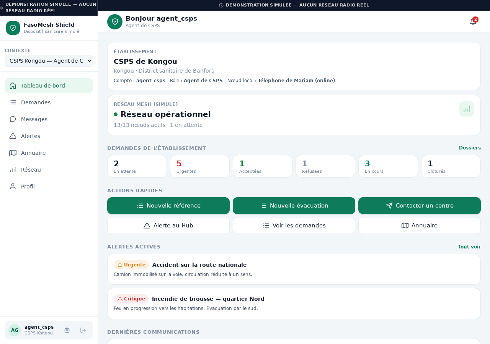
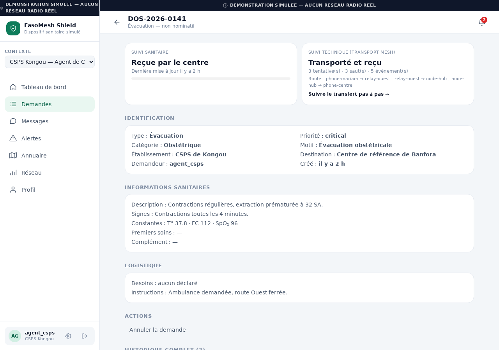
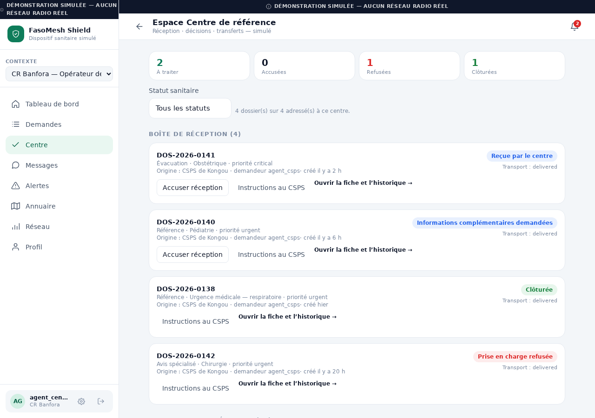
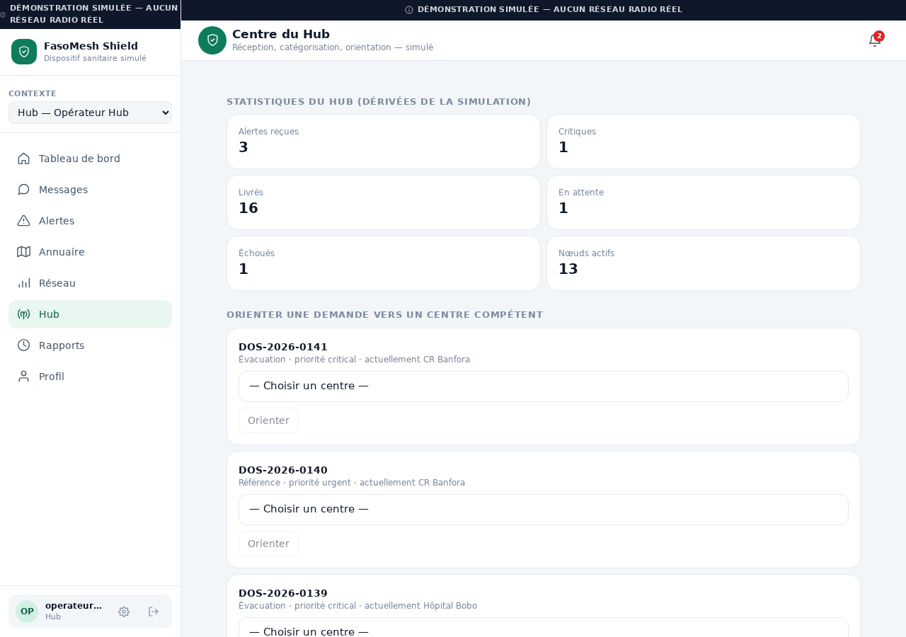

# FasoMesh Shield : simulation CSPS

Application de **démonstration** de coordination sanitaire centrée sur le CSPS (Centre de Santé et de Promotion Sociale), reposant sur un **réseau mesh LoRa simulé**.

> **Important.** Tout est simulé dans le navigateur. Il n'y a **aucune transmission radio réelle**, aucun serveur, aucune donnée médicale réelle et aucun dispositif médical certifié. Les délais, pertes et retransmissions affichés sont calculés par le moteur de simulation, pas mesurés sur le terrain.

Projet présenté au **Prix du Jeune Inventeur du Faso, édition 2026**.

---

## Vidéo de la simulation

[](docs/media/demo-simulation.mp4)

**Cliquez sur l'image pour lancer la vidéo** (environ 25 minutes, 25 Mo, lecture directement dans GitHub). Le fichier est dans `docs/media/demo-simulation.mp4`.

> Consignes pour remplacer ou mettre à jour la vidéo : [`docs/media/README.md`](docs/media/README.md).

---

## Le problème et l'idée

Dans un CSPS isolé, un agent de santé n'a souvent ni Internet ni réseau mobile fiable pour demander une évacuation ou un avis au centre de référence. FasoMesh Shield imagine un réseau de nœuds radio qui se relaient les messages : si un nœud tombe, le message passe par une autre route.

Cette simulation sert à **montrer le parcours complet** d'une demande, du CSPS jusqu'au centre de référence, en passant par le Hub, et à étudier le comportement du réseau (pertes, retransmissions, panne d'un relais).

## Aperçu

| Tableau de bord CSPS | Fiche d'un dossier |
|:---:|:---:|
|  |  |

| Espace Centre de référence | Espace Hub |
|:---:|:---:|
|  |  |

Version téléphone : [`m01`](artifacts/screens/m01-tableau-de-bord.png), [`m02`](artifacts/screens/m02-demandes.png), [`m03`](artifacts/screens/m03-formulaire.png), [`m04`](artifacts/screens/m04-espace-centre.png), [`m05`](artifacts/screens/m05-espace-hub.png). Toutes les captures sont dans [`artifacts/screens/`](artifacts/screens/).

## Fonctionnalités principales

- **Espace CSPS** : demandes de référence, d'évacuation et d'avis, brouillons, validation selon la priorité, suivi de la réception technique et du suivi sanitaire, messagerie chiffrée, alertes, annuaire, rapports avec export CSV, gestion d'équipe.
- **Espace Centre de référence** : boîte de réception, accusé, acceptation, refus motivé, demande d'informations, instructions au CSPS, suivi du transfert, clôture avec compte rendu.
- **Espace Hub** : catégorisation et accusé des alertes, orientation vers un établissement, files d'attente avec reprise, supervision des nœuds et liaisons, incidents réseau, journaux techniques.
- **Moteur Mesh** : routage multi saut, pertes simulées, retransmissions, accusés, détection de doublons, repli de stockage au Hub.
- **Sécurité de démonstration** : permissions appliquées dans la logique métier, isolation par organisation, journal d'audit, contenu des messages chiffré en AES-GCM.

Le détail de ce qui est implémenté, simulé ou non réalisé se trouve dans [`docs/FONCTIONNALITES.md`](docs/FONCTIONNALITES.md).

## Installation

**Prérequis** : Node.js 18 ou plus récent, et un navigateur récent.

```bash
git clone https://github.com/<votre-compte>/fasomesh-shield-simulation.git
cd fasomesh-shield-simulation
npm ci
npm run dev
```

L'application s'ouvre sur <http://localhost:3000>.

Autres commandes :

```bash
npm run typecheck   # vérification TypeScript
npm test            # 20 fichiers de tests, 196 tests
npm run build       # build de production dans dist/
npm run preview     # sert le build de production
```

## Comptes de démonstration

Mot de passe commun : **`fasomesh`**. L'écran de connexion liste aussi les comptes et les remplit au clic.

| Identifiant | Espace | Établissement |
|---|---|---|
| `responsable_csps` | CSPS | CSPS de Kongou (responsable) |
| `agent_csps` | CSPS | CSPS de Kongou (agent de santé) |
| `agent_csps2` | CSPS | CSPS de Daboya (agent de santé) |
| `agent_centre_reference` | Centre de référence | Centre de référence de Banfora |
| `agent_hopital` | Centre de référence | Hôpital régional de Bobo |
| `operateur_hub` | Hub | Hub Central |
| `administrateur` | Administration | Administration du réseau |
| `multi_roles` | CSPS et Hub | Démontre le changement de contexte |

Établissements, localités et nœuds simulés : [`docs/INSTALLATION.md`](docs/INSTALLATION.md).

## Parcours de démonstration conseillé

1. Connectez vous avec `agent_csps` et ouvrez le tableau de bord.
2. Créez une demande de **référence** et envoyez la : elle traverse le moteur Mesh.
3. Ouvrez le suivi pour voir la **route** empruntée, pas à pas.
4. Avec `operateur_hub`, **coupez un nœud** et observez la route alternative.
5. Avec `agent_centre_reference`, acceptez la demande, donnez des instructions, puis clôturez.

Le guide complet est dans [`docs/DEMO_CSPS.md`](docs/DEMO_CSPS.md).

## Technologies

React 18, TypeScript, Vite, Tailwind CSS 4, Zustand, React Router, Vitest et Testing Library. Les données sont conservées localement (IndexedDB avec repli localStorage).

## Structure du dépôt

```
src/
  mesh/        moteur Mesh : graphe, routage, simulation
  sim/         scénarios, métriques, activité
  domain/      règles métier (messages, alertes, soins, rapports)
  policy/      couche de permissions
  org/         organisations et habilitations
  infra/       chiffrement, persistance, données de démonstration
  services/    services applicatifs
  ui/          écrans et composants
  tests/       tests unitaires et de scénarios
docs/          conception, guides, rapports, démo
artifacts/     captures d'écran
tools/         vérification visuelle automatisée
```

## Documentation

| Document | Contenu |
|---|---|
| [`INSTALLATION.md`](docs/INSTALLATION.md) | Installation, comptes, réinitialisation |
| [`FONCTIONNALITES.md`](docs/FONCTIONNALITES.md) | Implémenté, simulé, non réalisé |
| [`CONCEPTION_CSPS.md`](docs/CONCEPTION_CSPS.md) | Conception de la version CSPS |
| [`GUIDE_CSPS.md`](docs/GUIDE_CSPS.md), [`GUIDE_CENTRE.md`](docs/GUIDE_CENTRE.md), [`GUIDE_HUB.md`](docs/GUIDE_HUB.md) | Guides par espace |
| [`RAPPORT_CSPS.md`](docs/RAPPORT_CSPS.md), [`RAPPORT_TECHNIQUE.md`](docs/RAPPORT_TECHNIQUE.md) | Rapports |
| [`RAPPORT_TESTS.md`](docs/RAPPORT_TESTS.md) | Résultats de tests |

## Limites assumées

- Comptes et mots de passe **locaux** : la couche de permissions démontre une logique d'autorisation, elle ne protège pas contre un utilisateur qui modifie les données de son appareil.
- La simulation calcule routes, pertes et délais, mais **aucun équipement radio n'émet**. Les performances réelles (portée LoRa, taux de livraison, autonomie) restent à mesurer sur un prototype matériel.
- Disponibilités des établissements et annuaire : **fictifs**, pas un référentiel officiel.

## Équipe

Projet FasoMesh Shield, Prix du Jeune Inventeur du Faso 2026.

<!-- Ajoutez ici les noms, rôles et liens GitHub des membres de l'équipe. -->

## Licence

Ce projet est publié sous licence **MIT**. Voir le fichier [`LICENSE`](LICENSE).
